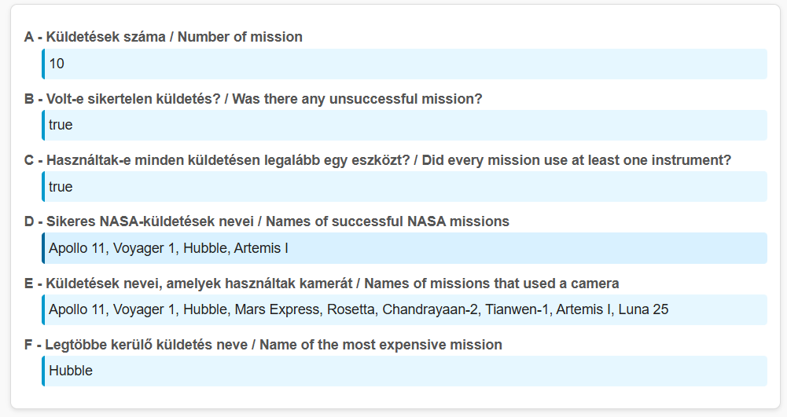
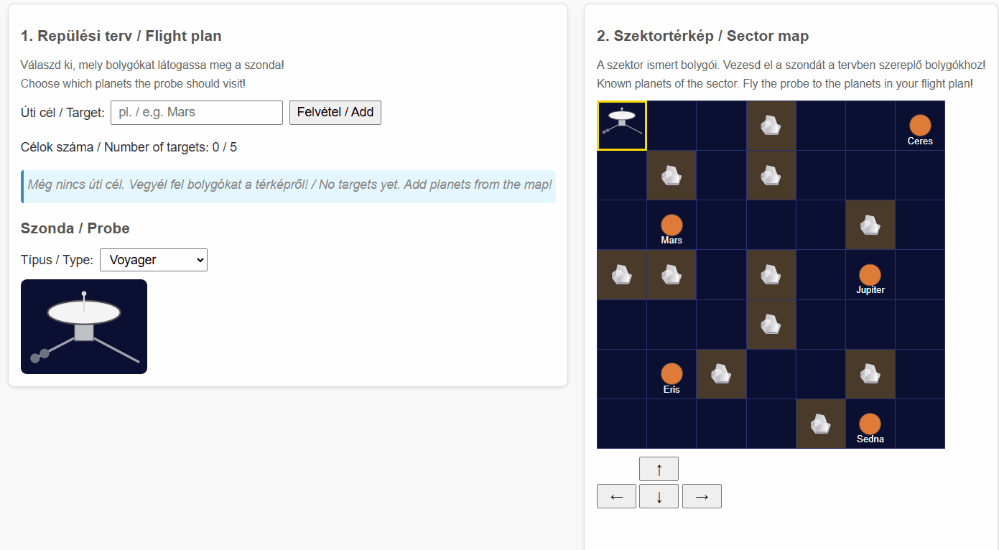
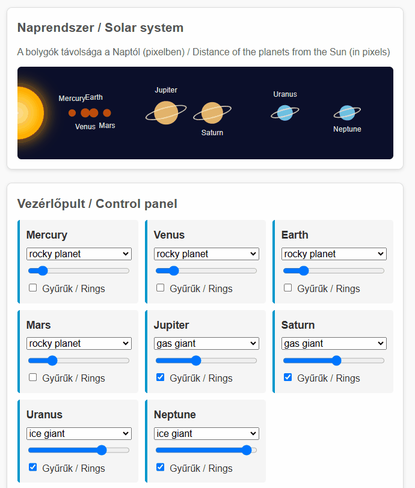

# JavaScript exam

## Important Information

### What should I do before the exam starts?

- **Place a photo ID on your desk:** This can be your national ID card, driver's license, passport, or ELTE student ID card — the important thing is that we can identify you based on it.
- **Put your belongings at the side of the room and leave your phone in your bag:** No personal belongings may be kept on your desk during the exam. Coats and bags must be placed against the wall. You must not have a phone, USB drive, etc. with you. If any such item is found, you will automatically fail the course. We also recommend emptying your pockets to avoid any misunderstandings.
- **Stay hydrated and use the restroom beforehand:** You are not allowed to temporarily leave the room during the exam — leaving the room automatically terminates your exam.
- **Download your supplementary materials:** If you have uploaded supplementary materials to the Exam System, we recommend downloading and organizing them now.

### How much time do I have?

- The exam duration is **2 hours**. The expected end time is 19:45, although this may be delayed depending on any delays caused by seating arrangements. You can check the exact time in the Exam System.
- The time limit **includes** not only solving the tasks, but also downloading the starter files, understanding the assignments, preparing your solution for submission, and uploading it.
- Once the system closes, no extensions can be granted. Your solution must be uploaded by the deadline specified in the Exam System. Therefore, we strongly recommend that **you dedicate the final 10 minutes of the exam exclusively to submitting your work!** An unsuccessful upload attempt left until the last minute will result in a failing grade just like any other failed submission.
- If you finish early, submit your solution in the exam system, then **silently** walk to the door. Please, **wait for a teacher** before leaving. **Remember, you can NOT come back when you leave!**

### What tools and materials will I use?

- When the exam begins, the assignment description will appear in the Exam System, and a starter package will become available for download. You will need to download and extract this package. It contains two things: the starter code for the assignments and the exam assistance program.
- Make sure to read the **ExamAssistant** program documentation thoroughly. This tool is designed to help you complete the assignments without technical difficulties and verify the quality of your solution locally.
- ExamAssistant provides the following features:
  - Filling in the README file;
  - Opening the starter code in VS Code;
  - Running local tests on your code (this is faster and runs the same tests as the submission system);
  - Packaging your code in the required format (ZIP) and opening the folder containing the package.
- Your code can therefore be tested in three ways:
  - Manual testing during development (required);
  - Automated local tests (fast);
  - Automated server-side tests (slow).
- During the exam, and at least once before it ends, you must upload your completed code to the Exam System. The Exam System stores the file and forwards it to the Progenv system, which runs the automated tests. Your score will also be displayed in the Exam System (ideally matching your local score), and will be available in the Progenv system after the exam.
- In addition to the materials you have uploaded, you can also use:
  - [Mozilla Developer Network](https://developer.mozilla.org/en-US/) as language documentation
  - [lecture slides](https://webprogramozas.inf.elte.hu/webprog/lectures-pdf-en/) that are downloadable as PDF

### What must I NOT use?

Including, but not limited to:
- Human assistance (synchronous or asynchronous communication, chats, forums, etc.), except for asking the supervising instructors for help.
- Artificial intelligence (ChatGPT, Bing AI, GitHub Copilot, extensions providing AI-powered code completion or assistance, etc.).
- VS Code extensions of your own choosing.

### What else should I know?

- The assignments (1, 2, 3) **are independent of one another** and can be completed in any order.
- Subtasks (a, b, c, etc.) within an assignment may depend on one another. However, it is worth reading through all of them, even if you plan to skip an assignment, as some subtasks may be independent and easier to complete.
- In most cases, modifying the `.js` file alone is sufficient. If you modify the HTML/CSS files, you are probably overcomplicating your solution.
- The assignments must be solved programmatically, not through hardcoded solutions!
- Full credit can only be awarded for solutions that work correctly without runtime errors.

## Lore

NASA and the European Space Agency have brought the Cosmos 2030 project to Hungary. As part of this initiative, new systems must be developed to ensure that future explorations and missions run smoothly, even when communication delays caused by vast distances become a challenge.

## Starter Package

You can download the starter package by [clicking HERE](TODO). Extract the archive and then run the `ExamAssistant.exe` program!

## Tasks

### 1. Space Missions (task-1, 12 points)

Create the main statistics about past space missions!

In the `index.js` file, you have access to the `spaceMissions` variable defined in the `data.js` file.

`spaceMissions` is an array containing objects that describe space missions. Each mission contains the following data:

- the name of the mission (`name`),
- the name of the space agency (`agency`),
- the year of the mission (`year`),
- the destination of the mission (`destination`),
- whether the mission was crewed (`crewed`, boolean),
- the duration of the mission in days (`durationDays`),
- whether the mission was successful (`successful`, boolean),
- the cost of the mission in millions of dollars (`costMillionUSD`),
- and the list of instruments used during the mission (`instruments`), stored as an array.

Complete the following tasks:

- a. (1 point) Write the total number of missions into the `taskA` element.
- b. (2 points) Write into the `taskB` element whether there was at least one _unsuccessful_ mission.
- c. (2 points) Write into the `taskC` element whether every mission used at least one instrument.
- d. (2 points) Write the names of the successful _NASA missions_ into the `taskD` element, separated by commas.
- e. (2 points) Write the names of the missions that used a _camera_ into the `taskE` element.
- f. (3 points) Write the name of the most expensive successful mission into the `taskF` element.

### 2. Exploration Route Planner (task-2, 14 points)

NASA is launching a new exploration probe to the edge of the Solar System. The sector map shows the known planets of the sector, their names can be read in their cells. First, you have to put together the probe's flight plan: you add the names of the planets that the probe has to visit. Then you have to guide the probe across the map to the planets in the plan.

The `index.html` and `index.css` files already contain every necessary element and class, write your solution into the `index.js` file! `index.js` already contains the `probeRow` and `probeCol` variables storing the position of the probe, the `getCell(row, col)` helper function, which returns the cell in the given row and column of the table, and constants storing the elements listed below (e.g. `targetInput`, `route`, `moveUpButton`). Use them, but do not declare them again, otherwise the whole file stops with an error!

You will find the following elements on the page:

- a text input field (`#target-input`) and a button (`#add-target`) for adding targets,
- a numbered list (`ol#route`) containing the flight plan, and an element (`#route-count`) for displaying the number of targets,
- a dropdown (`select#probe-select`) with the values `voyager`, `pioneer`, `new-horizons`, and an image (`img#probe-image`),
- a 7×7 table (`table#sector`) representing the sector map. Some cells have the `asteroid` class (asteroid field), others have the `planet` class and store the name of the planet in their `data-name` attribute,
- four control buttons (`#move-up`, `#move-down`, `#move-left`, `#move-right`),
- an element (`#status`) for displaying the state of the mission.

Complete the following tasks:

- Flight plan:
  - a. (1 point) When the `#add-target` button is clicked, add the content of the `#target-input` field as a new list item (`li`) to the `#route` list! The text of the list item should be the typed name.
  - b. (1 point) Remove the spaces from the beginning and the end of the typed text (`trim()`)! If the remaining text is empty, no new item should be added to the list. After a successful addition, clear the input field!
  - c. (2 points) Handle the capacity of the probe!
    - (1 point) The `#route-count` element should always show the number of targets in the list!
    - (1 point) Once the list has 5 items, the `#add-target` button should be disabled (`disabled`)!
  - d. (1 point) When the `#probe-select` dropdown changes (`change`), set the `src` attribute of the `#probe-image` image to `img/<value>.svg`, where `<value>` is the value of the selected option (e.g. `img/voyager.svg`)!
- Sector map: only add and remove the `probe` class on the cells; their other classes (`asteroid`, `planet`) and their `data-name` attribute must stay (use `classList`, not `className`)! Subtasks e–g check this too.
  - e. (1 point) When the page loads, the probe should be in the top left cell of the table (row 0, column 0): this cell should get the `probe` class! Exactly one cell should have the `probe` class at all times.
  - f. (2 points) When a control button is clicked, the probe should move one cell in the corresponding direction: the `probe` class should be removed from its old cell and added to the new one! Don't forget to update the `probeRow` and `probeCol` variables!
    - (1 point) The `#move-right` button works.
    - (1 point) All four buttons work.
  - g. (2 points) If the move is not possible, the probe should stay in place!
    - (1 point) The probe must not leave the map!
    - (1 point) The probe must not move onto a cell with the `asteroid` class!
  - h. (4 points) Complete the mission!
    - (2 points) If the probe moves onto a `planet` cell whose `data-name` value matches the text of an item of the flight plan (`#route`) exactly (case-sensitively), that list item should get the `visited` class! Only the targets already added at the moment of the move have to be marked. _(Example: if `Mars` is in the plan and the probe moves onto the `data-name="Mars"` cell, the `Mars` list item becomes `visited`. A `mars` list item, or `Pluto`, which is not on the map, never becomes `visited`.)_
    - (2 points) When every item of the flight plan has become `visited`, write `Mission complete!` into the `#status` element (the Hungarian `Küldetés teljesítve!` is also accepted)! Until then, the `#status` element should stay empty!

### 3. Solar System Control (task-3, 14 points)

Create a control panel for the model of the Solar System! It should be possible to change the distance, the color and the rings of the planets. Handle the events of the controls with **delegation**!

Write your solution into the `index.js` file! By default, the `planets` array is loaded from the `data.js` file. For this task you will need the `name`, `type`, `distanceFromSun` (million km), `diameter` (km) and `hasRings` data of the planets.

Generate the planets into the `#planets` element, next to the Sun already there, and the controls into the empty `#input-fields` element! You will find an HTML sample as a comment in both places. The necessary styles are in the `index.css` file; use the IDs, classes, attributes and events given in the task!

The starter package contains three helper functions:

- `delegate(parent, type, selector, handler)`: the helper function shown in the lecture. It handles the `type` type event on the `parent` element, and if the event happened on (or inside) an element matching the `selector`, it calls the `handler` function: inside it, `this` is the matching element and its parameter is the event object (so pass a `function`, not an arrow function). Using it is not mandatory.
- `distanceToPx(distance)`: converts the distance from the Sun from million kilometers to pixels.
- `diameterToPx(diameter)`: converts the diameter from kilometers to pixels.

`index.js` also contains the `inputFields` and `planetsDiv` constants storing the `#input-fields` and `#planets` elements; do not declare them again!

In the `data-index` attributes, always use the index of the planet in the `planets` array (0, 1, 2, …)! Produce the list of different types programmatically from the array, in the order of their first occurrence. The **type index** is the position of the type in this list: 0 – `rocky planet` / `kőzetbolygó`, 1 – `gas giant` / `gázóriás`, 2 – `ice giant` / `jégóriás`. Take the displayed type names from the loaded data!

- Generation
  - a. (1 point) For every planet, generate a `div` element with the `planet-control` class into the `#input-fields` element, in the order of the `planets` array! Each should contain an `h3` element with the name of the planet.
  - b. (2 points) Generate a dropdown (`select`) with the `planet-color` class into every `.planet-control` element! Its `data-index` attribute should be the index of the planet.
    - (1 point) The `option` elements should contain the different planet types in the order of the type index. Their `value` should be the type index, and their text should be the name of the type!
    - (1 point) Initially, the planet's own type should be selected!
  - c. (1 point) Generate a slider (`input`, `type="range"`) with the `planet-orbit` class and the index of the planet in its `data-index` attribute into every `.planet-control` element! Its `min` value should be `0`, its `max` value `500`, and its initial value `distanceToPx(distanceFromSun)`.
  - d. (1 point) Generate a checkbox (`input`, `type="checkbox"`) with the `planet-rings` class and the index of the planet in its `data-index` attribute into every `.planet-control` element! It should be checked (`checked`) if the planet has rings (`hasRings`). Using the `label` element shown in the sample is not mandatory.
  - e. (2 points) For every planet, generate a `span` element with the `planet` class into the `#planets` element! Write the index of the planet into its `data-index` attribute, and the name of the planet into its `title` attribute.
    - (1 point) The `span` should get the `type-<type index>` class (e.g. Mars `type-0`, Jupiter `type-1`), and if the planet has rings, the `rings` class as well!
    - (1 point) The `left` style property of the `span` should be `distanceToPx(distanceFromSun)`, and its width (`width`) and height (`height`) should be `diameterToPx(diameter)` pixels (e.g. for Mars `left: 106px`, `width: 12px`, `height: 12px`)!
- Event handling
  - f. (2 points) When a `.planet-orbit` slider is moved (`input` event), set the `left` style property of the planet with the same `data-index` value to the value of the slider, in pixels!
  - g. (1 point) When a `.planet-color` dropdown changes (`change` event), the planet with the same `data-index` value should get the `type-<type index>` class belonging to the selected type! Remove the class of the previous type; the planet should have only one `type-*` class at a time!
  - h. (1 point) When a `.planet-rings` checkbox changes (`change` event), the planet with the same `data-index` value should have the `rings` class if the checkbox is checked! Otherwise, remove it!
  - i. (3 points) Solve subtasks f–h with **delegation**: register the event handlers not on the individual controls but on a common ancestor of theirs (e.g. the `#input-fields` element)! You may use the given `delegate` function, or `event.target` as well. 1 point per control type: slider, dropdown, checkbox.
