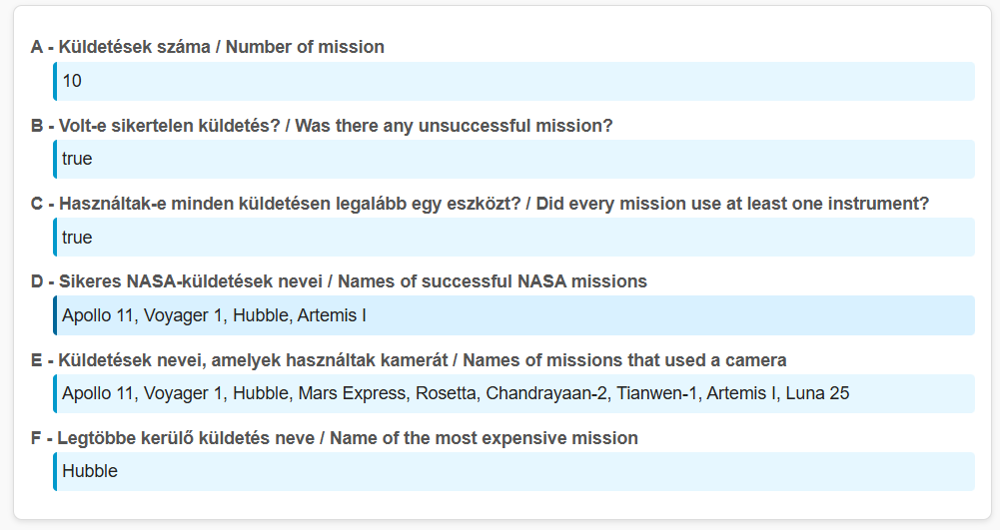
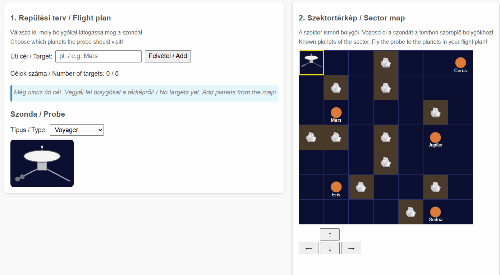
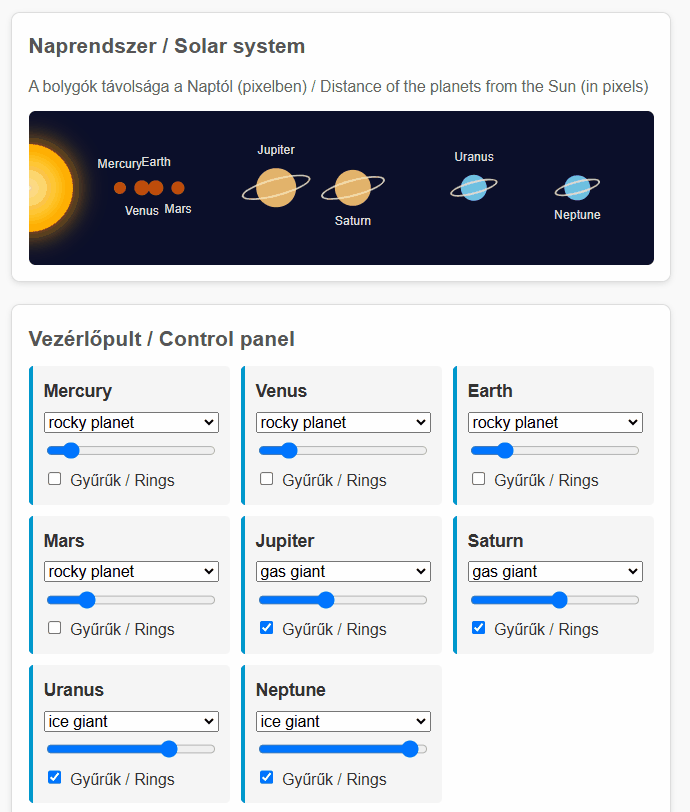

# JavaScript zárthelyi

## Tudnivalók

### Mit tegyek a ZH kezdése előtt?
- **Készíts ki egy fényképes okmányt az asztalra:** Ez lehet személyi igazolvány, vezetői engedély, útlevél vagy ELTE-s diákigazolvány is — a lényeg, hogy ez alapján beazonosítható legyél.
- **Pakold a cuccaidat a terem szélére, a telefonod hagyd a táskádban:** A ZH során semmilyen saját tárgy nem lehet az asztalon. A kabátokat és táskákat a fal mellé kell helyezni. Telefon, pendrive, stb sem lehet nálad. Ha ilyet találunk, az azonnali bukást jelent a tárgyból. Érdemes a zsebeket is kiüríteni a félreértések elkerülése végett.
- **Hidratálj és menj el mosdóba is:** A ZH során a termet ideiglenesen elhagyni nem lehet — a teremből való kilépés a ZH automatikus befejezését jelenti.
- **Töltsd le a segédanyagaidat:** Ha töltöttél fel segédanyagokat a ZH rendszerbe, érdemes most letölteni és elrendezni őket.

### Meddig írhatom?
- A ZH munkaideje **2 óra**, várható befejezése 19:45, ami az ültetés okozta esetleges csúszás függvényében tolódhat. A pontos időadatot a ZH rendszerben láthatod.
- Az időkeret **magába foglalja** a feladatok megoldása mellett a kiinduló állományok letöltését, a feladat értelmezését, a megoldás összekészítését és annak feltöltését.
- Ha a rendszer lezárt, utólagos hosszabbításra nincs lehetőség. A feladatot a ZH rendszerben megadott határidőig kell feltölteni, ezért javasoljuk, hogy **a ZH utolsó 10 percében már csak a beadással foglalkozz!** Az utolsó pillanatra hagyott sikertelen feltöltés ugyanúgy elégtelen érdemjeggyel jár.
- Ha korábban végzel, add be a végleges megoldásodat a rendszerben, majd **csendben** fáradj a terem ajtajához. Kérjük, **várj meg** egy felügyelőtanárt a teremből való kilépés előtt. **Ne feledd, ha elhagyod a termet, nem jöhetsz vissza!**

### Mit fogok használni?
- A ZH kezdetekor a ZH rendszerben megjelenik a feladat leírása és letölthetővé válik egy kezdőcsomag. Ezt kell majd letöltened és kicsomagolnod. Két dolgot találsz benne: az elvégzendő feladatok kiinduló kódjait és a vizsgasegéd programot.
- Mindenképpen olvasd végig a **Vizsgasegéd** program dokumentációját, ugyanis ez téged segít, hogy minden technikai akadály nélkül oldhasd meg a feladatokat, és helyben meggyőződhess a megoldásod minőségéről.
- Az ExamAssistant segítségével a következő feladatok végezhetők el:
  - a README fájl kitöltése;
  - a starter kód megnyitása VSCode-ban;
  - a kód lokális tesztelése (gyorsabb ezt használni, és ugyanazok a tesztek futnak le, mint beadáskor);
  - a kód kívánt formátumú becsomagolása (zip), és a tartalmazó mappa megnyitása.
- A kód tesztelése tehát három módon valósulhat meg:
  - fejlesztés közbeni manuális tesztelés (szükséges)
  - automatikus lokális tesztek (gyors)
  - automatikus szerver tesztek (lassú)
- A ZH közben, de legalább egyszer a végén az elkészült kódot fel kell tölteni a ZH rendszerbe. A ZH rendszer eltárolja a fájlt, és továbbküldi a Progenv rendszernek, ami az automatikus teszteléseket végzi. A pontszámot a ZH rendszer is kijelzi (jó esetben a lokális pontszámmal megegyező értékben), és a ZH után a Progenv rendszerben is látható lesz.
- A feltöltött segédanyagaid mellett használható még:
  - a [Mozilla Developer Network](https://developer.mozilla.org/en-US/) mint nyelvi dokumentáció
  - az [előadásdiák](https://webprogramozas.inf.elte.hu/webprog/lectures-pdf/) PDF-ben letölthető változtatai

### Mit NE használjak?
Többek közt:
- Emberi segítség (szinkron, aszinkron, chat, fórum, stb.), kivéve a felügyelő tanároktól történő segítségkérést.
- Mesterséges intelligencia (ChatGPT, Bing AI, GitHub Copilot, AI kódkiegészítést/segítséget tartalmazó kiegészítők, stb.).  
- Általad összeválogatott VS Code kiegészítőket.

### Mit kell még tudnom?
- A feladatok (1, 2, 3) **nem épülnek egymásra**, tetszőleges sorrendben megoldhatók.
- A részfeladatok (a, b, c...) egy feladaton belül egymásra épülhetnek, de érdemes végigolvasni mindet, akkor is, ha át tervezed ugrani a feladatot, mert lehet független, egyszerűbb részfeladat.
- A feladatokban általában a `.js` fájl módosítása elegendő. Ha a HTML/CSS fájlokat módosítod, valószínűleg túlbonyolítod a megoldást.
- A feladatokat programozottan kell megoldani, nem beégetett megoldásokkal!
- Teljes pont csak működő, futásidejű hiba nélküli megoldásra adható.

## Lore
A NASA és az Európai Űrügynökség Magyarországra hozta a Kozmosz 2030 projektet. Ennek keretében új rendszereket kell kifejleszteni, hogy a jövőbeli felderítések és missziók zökkenőmentesen működhessenek még a távolság okozta kommunikációs időeltolódás mellett is.

## Kezdőcsomag

A kezdőcsomagot [IDE kattintva](TODO) tudod letölteni. Csomagold ki, majd futtasd az `ExamAssistant.exe` programot!

## Feladatok

### 1. Űrmissziók (task-1, 12 pont)

Készítsd el a fő statisztikákat az eddigi űrmissziókról!

A `index.js` fájlban hozzáférsz a `data.js` fájlban definiált `spaceMissions` változóhoz.

A `spaceMissions` egy tömb, amely űrküldetéseket leíró objektumokat tartalmaz. Minden küldetéshez az alábbi adatok tartoznak:

- a küldetés neve (`name`),
- az űrügynökség neve (`agency`),
- a küldetés éve (`year`),
- a küldetés célpontja (`destination`),
- emberes küldetés volt-e (`crewed`, boolean),
- a küldetés időtartama napokban (`durationDays`),
- sikeres volt-e a küldetés (`successful`, boolean),
- a küldetés költsége millió dollárban (`costMillionUSD`),
- valamint a küldetés során használt eszközök listája (`instruments`), tömb formájában.

Oldd meg az alábbi feladatokat:

- a. (1 pont) A `taskA` elembe írd ki, hány küldetés volt összesen!
- b. (2 pont) A `taskB` elembe írd ki, volt-e legalább egy _sikertelen_ küldetés!
- c. (2 pont) A `taskC` elembe írd ki, hogy használtak-e minden küldetésen legalább egy eszközt!
- d. (2 pont) A `taskD` elembe írd ki a sikeres _NASA-küldetések_ neveit, vesszővel elválasztva!
- e. (2 pont) A `taskE` elembe írd ki azoknak a küldetéseknek a nevét, amelyek során _kamerát_ használtak!
- f. (3 pont) A `taskF` elembe írd ki annak a sikeres küldetésnek a nevét, amelyik a legtöbbe került!

### 2. Felderítő útvonaltervező (task-2, 14 pont)

A felderítőszondák küldetéseit egy szektortérképen vezénylik az ügynükségek. A szektortérképen a szektor ismert bolygói láthatók, a nevük a cellájukban olvasható. Először össze kell állítanod a szonda repülési tervét: ebbe azoknak a bolygóknak a nevét veszed fel, amelyeket a szondának meg kell látogatnia. Ezután végig kell vezetned a szondát a térképen a tervben szereplő bolygókhoz.

Az `index.html` és az `index.css` fájl már tartalmaz minden szükséges elemet és stílusosztályt, a megoldásodat az `index.js` fájlba írd! Az `index.js` már tartalmazza a szonda helyzetét tároló `probeRow` és `probeCol` változót, a `getCell(row, col)` segédfüggvényt, amely a táblázat adott sorában és oszlopában lévő cellát adja vissza, valamint az alább felsorolt elemeket tároló konstansokat (pl. `targetInput`, `route`, `moveUpButton`). Ezeket használd, de ne deklaráld újra őket, különben a teljes fájl hibával leáll!

Az oldalon az alábbi elemeket találod:

- egy szöveges beviteli mezőt (`#target-input`) és egy gombot (`#add-target`) az úti célok felvételéhez,
- egy számozott listát (`ol#route`), amely a repülési tervet tartalmazza, és egy elemet (`#route-count`) a célok számának kiírásához,
- egy legördülő listát (`select#probe-select`), amelynek értékei: `voyager`, `pioneer`, `new-horizons`, valamint egy képet (`img#probe-image`),
- egy 7×7-es táblázatot (`table#sector`), amely a szektortérképet ábrázolja. Egyes cellák `asteroid` stílusosztályúak (aszteroidamező), mások `planet` stílusosztályúak, és a `data-name` attribútumukban a bolygó nevét tárolják,
- négy irányító gombot (`#move-up`, `#move-down`, `#move-left`, `#move-right`),
- egy elemet (`#status`) a küldetés állapotának kiírásához.

Oldd meg az alábbi feladatokat:

- Repülési terv:
  - a. (1 pont) Az `#add-target` gombra kattintva a `#target-input` mező tartalmát vedd fel új listaelemként (`li`) az `#route` listába! A listaelem szövege a beírt név legyen.
  - b. (1 pont) A beírt szöveg elejéről és végéről távolítsd el a szóközöket (`trim()`)! Ha így üres szöveg marad, ne kerüljön új elem a listába. Sikeres felvétel után ürítsd ki a beviteli mezőt!
  - c. (2 pont) Kezeld a szonda kapacitását!
    - (1 pont) A `#route-count` elemben mindig a listában lévő úti célok száma legyen olvasható!
    - (1 pont) Ha a lista elérte az 5 elemet, az `#add-target` gomb legyen letiltva (`disabled`)!
  - d. (1 pont) A `#probe-select` legördülő lista változásakor (`change`) a `#probe-image` kép `src` attribútumát állítsd `img/<érték>.svg`-re, ahol `<érték>` a kiválasztott opció értéke (pl. `img/voyager.svg`)!
- Szektortérkép: a cellákon csak a `probe` stílusosztályt tedd fel, illetve vedd le; a többi stílusosztályuk (`asteroid`, `planet`) és a `data-name` attribútumuk maradjon meg (`classList`-et használj, ne `className`-et)! Az e–g. részfeladatok ezt is ellenőrzik.
  - e. (1 pont) Az oldal betöltésekor a szonda a táblázat bal felső cellájában (0. sor, 0. oszlop) legyen: a cella kapja meg a `probe` stílusosztályt! Mindig pontosan egy cellán legyen `probe` stílusosztály.
  - f. (2 pont) Az irányító gombokra kattintva a szonda lépjen egy cellát a megfelelő irányba: a régi cellájáról kerüljön le, az újra kerüljön fel a `probe` stílusosztály! Ne felejtsd el frissíteni a `probeRow` és `probeCol` változót!
    - (1 pont) A `#move-right` gomb működik.
    - (1 pont) Mind a négy gomb működik.
  - g. (2 pont) Ha a lépés nem lehetséges, a szonda maradjon a helyén!
    - (1 pont) A szonda ne hagyhassa el a térképet!
    - (1 pont) A szonda ne léphessen `asteroid` stílusosztályú cellára!
  - h. (4 pont) Fejezd be a küldetést!
    - (2 pont) Ha a szonda olyan `planet` cellára lép, amelynek `data-name` értéke pontosan (kis- és nagybetűre is) megegyezik a repülési terv (`#route`) valamelyik elemének szövegével, akkor az a listaelem kapja meg a `visited` stílusosztályt! Csak a lépés pillanatában már felvett célokat kell megjelölni. _(Példa: ha a tervben szerepel a `Mars`, és a szonda a `data-name="Mars"` cellára lép, a `Mars` listaelem `visited` lesz. A `mars` vagy a térképen nem szereplő `Pluto` listaelem soha nem lesz `visited`.)_
    - (2 pont) Amikor a repülési terv minden eleme `visited` lett, írd ki a `#status` elembe: `Küldetés teljesítve!` (angolul `Mission complete!` is elfogadott). Addig a `#status` elem maradjon üres!

### 3. Naprendszer-vezérlő (task-3, 14 pont)

Készíts vezérlőpultot a Naprendszer modelljéhez! A bolygók távolságát, színét és gyűrűit lehessen változtatni. A vezérlők eseményeit **delegálással** kezeld!

A megoldásodat az `index.js` fájlba írd! A `planets` tömböt alapértelmezés szerint a `data.js` fájlból töltjük be. A feladathoz a bolygók `name`, `type`, `distanceFromSun` (millió km), `diameter` (km) és `hasRings` adataira lesz szükséged.

A bolygókat a `#planets` elembe generáld, a már ott lévő Nap mellé, a vezérlőket pedig az üres `#input-fields` elembe! Mindkét helyen találsz egy HTML-mintát megjegyzésként. A szükséges stílusok az `index.css` fájlban vannak; használd a feladatban megadott azonosítókat, stílusosztályokat, attribútumokat és eseményeket!

A kezdőcsomagban három segédfüggvényt adtunk:

- `delegate(parent, type, selector, handler)`: az előadáson bemutatott segédfüggvény. A `parent` elemen kezeli a `type` típusú eseményt, és ha az a `selector` szelektorra illeszkedő elemen (vagy azon belül) történt, meghívja a `handler` függvényt: ebben a `this` az illeszkedő elem, a paramétere pedig az eseményobjektum (ezért `function`-t adj át, ne nyílfüggvényt). Használata nem kötelező.
- `distanceToPx(distance)`: a Naptól mért távolságot millió kilométerről pixelre váltja.
- `diameterToPx(diameter)`: az átmérőt kilométerről pixelre váltja.

Az `index.js` a `#input-fields` és a `#planets` elemet tároló `inputFields` és `planetsDiv` konstanst is tartalmazza; ezeket ne deklaráld újra!

A `data-index` attribútumokban mindig a bolygó `planets` tömbbeli indexét használd (0, 1, 2, …)! A különböző típusok listáját programozottan állítsd elő a tömbből, az első előfordulásuk sorrendjében. A **típusindex** a típus helye ebben a listában: 0 – `rocky planet` / `kőzetbolygó`, 1 – `gas giant` / `gázóriás`, 2 – `ice giant` / `jégóriás`. A megjelenített típusneveket a betöltött adatokból vedd!

- Generálás
  - a. (1 pont) Minden bolygóhoz generálj egy `div` elemet `planet-control` stílusosztállyal a `#input-fields` elembe, a `planets` tömb sorrendjében! Mindegyikben legyen egy `h3` elem a bolygó nevével.
  - b. (2 pont) Minden `.planet-control` elembe generálj egy `planet-color` stílusosztályú legördülő listát (`select`)! A `data-index` attribútuma a bolygó indexe legyen.
    - (1 pont) Az `option` elemek a különböző bolygótípusokat tartalmazzák a típusindex sorrendjében. A `value` értékük a típusindex, a szövegük a típus neve legyen!
    - (1 pont) Kezdetben a bolygó saját típusa legyen kiválasztva!
  - c. (1 pont) Minden `.planet-control` elembe generálj egy csúszkát (`input`, `type="range"`) `planet-orbit` stílusosztállyal és a bolygó indexével a `data-index` attribútumában! A `min` értéke `0`, a `max` értéke `500`, a kezdőértéke pedig `distanceToPx(distanceFromSun)` legyen.
  - d. (1 pont) Minden `.planet-control` elembe generálj egy jelölőnégyzetet (`input`, `type="checkbox"`) `planet-rings` stílusosztállyal és a bolygó indexével a `data-index` attribútumában! Akkor legyen bejelölve (`checked`), ha a bolygónak van gyűrűje (`hasRings`). A mintában szereplő `label` elem használata nem kötelező.
  - e. (2 pont) Minden bolygóhoz generálj egy `span` elemet `planet` stílusosztállyal a `#planets` elembe! A `data-index` attribútumába a bolygó indexét, a `title` attribútumába a bolygó nevét írd.
    - (1 pont) A `span` kapja meg a `type-<típusindex>` stílusosztályt (pl. a Mars `type-0`, a Jupiter `type-1`), és ha a bolygónak van gyűrűje, a `rings` stílusosztályt is!
    - (1 pont) A `span` `left` stílustulajdonsága `distanceToPx(distanceFromSun)`, a szélessége (`width`) és a magassága (`height`) pedig `diameterToPx(diameter)` pixel legyen (pl. a Mars esetén `left: 106px`, `width: 12px`, `height: 12px`)!
- Eseménykezelés
  - f. (2 pont) Egy `.planet-orbit` csúszka mozgatásakor (`input` esemény) állítsd az azonos `data-index` értékű bolygó `left` stílustulajdonságát a csúszka értékére, pixelben!
  - g. (1 pont) Egy `.planet-color` lista változásakor (`change` esemény) az azonos `data-index` értékű bolygó kapja meg a kiválasztott típushoz tartozó `type-<típusindex>` stílusosztályt! Az előző típus stílusosztályát távolítsd el; egyszerre csak egy `type-*` stílusosztály legyen rajta!
  - h. (1 pont) Egy `.planet-rings` jelölőnégyzet változásakor (`change` esemény) az azonos `data-index` értékű bolygón akkor legyen `rings` stílusosztály, ha a jelölőnégyzet be van jelölve! Ellenkező esetben távolítsd el róla!
  - i. (3 pont) Az f–h. részfeladatokat **delegálással** oldd meg: az eseménykezelőket ne az egyes vezérlőkre, hanem egy közös ősükre (pl. a `#input-fields` elemre) regisztráld! Használhatod a megadott `delegate` függvényt, vagy az `event.target`-et is. Vezérlőtípusonként 1 pont jár: csúszka, legördülő lista, jelölőnégyzet.
